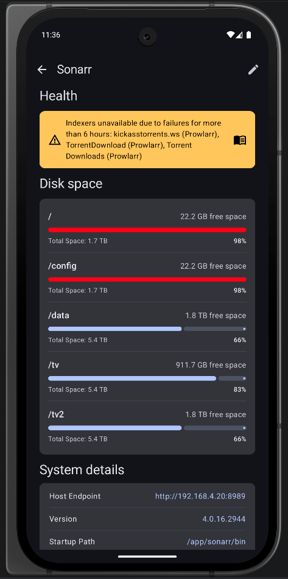
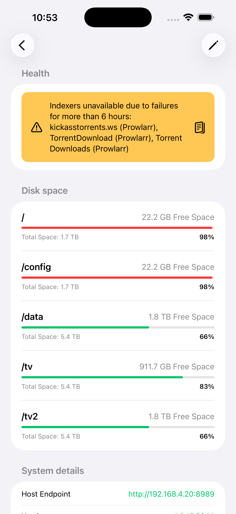

<div align="center">
  
  <h1 style="font-size: 28px; margin: 10px 0;">ArrMatey</h1>
  <p>A modern, all-in-one mobile client for managing your *arr stack. Built using KMP with native Jetpack Compose UI for Android and SwiftUI for iOS.</p>
</div>

[](LICENSE)
[](https://www.android.com)
[](https://kotlinlang.org)
[](https://www.apple.com/ios)
[](https://swift.org)

<a href="https://github.com?qj_open=1"></a>
<a href="https://www.buymeacoffee.com/owenlejeune" target="_blank"></a>

## Downloads

<a href="https://f-droid.org/packages/com.dnfapps.arrmatey/" target="_blank"></a>
<a href="https://apps.obtainium.imranr.dev/redirect?r=obtainium://add/https://github.com/owenlejeune/ArrMatey/"></a>
<a href="https://github.com/owenlejeune/ArrMatey/releases" target="_blank"></a>

## Features

### Combined Dashboard
- Centralized overview of all instances, download clients, requests, and watch activity
- Customizable layout: add, remove, and reorder cards to fit your workflow
- Continue Watching card for Plex, Jellyfin, and Emby media servers
- Dashboard cards for Universal Search, Seerr Requests, Seerr Issues, and Discover Cards (Discover Feed, Quick Pick, Spotlight)
- Tracearr & Tautulli stream monitoring cards with active streams and playback statistics
- Real-time network status, Wake-on-LAN controls, and detailed disk space monitoring
- Quick-access shortcuts to your recently added media and upcoming schedule

### Multi-Instance & Media Server Support
- Manage multiple Sonarr, Radarr, Lidarr, Bookshelf, Listenarr, and Kapowarr instances
- Browse and sync Plex, Jellyfin, and Emby media server libraries with live presence detection, playback controls, and watch status
- Seamless integration with Prowlarr for indexer management, Seerr for requests and issues, Bazarr for subtitles, Chaptarr for audiobook chapters, and Tracearr/Tautulli for stream monitoring
- Wake-on-LAN device management to power on sleeping servers directly from the app
- Quick instance switching and custom instance labels
- Live presence detection showing which instances contain a media item

### Unified Media Details
- Blends Arr library data, Media Server availability, Seerr metadata, and Bazarr subtitle controls into a single cohesive view
- **Instance Switching**: View media presence across multiple instances and switch between them instantly while preserving local instance context
- **Media Server Availability & Playback**: View media server badges, mark episodes/movies as watched or unwatched, and launch direct playback
- **Smart Add & Requests**: Add media directly to any configured Arr instance or submit custom Seerr requests with custom profiles, root folders, and tags
- **Seasons & Episodes**: Full episode monitoring, release search, playback statistics, and integrated Bazarr subtitle tracking
- **Cast & Crew Filmography**: Browse actor and crew credits with one-tap navigation to detailed filmographies
- **Similar Recommendations**: Browse similar media suggestions directly on media detail pages
- **Information & Keywords**: Distinct metadata cards with instance indicators and staggered keyword tags

### Media Server Libraries
- Dedicated media server library browsing for Plex, Jellyfin, and Emby
- Unified search integration with clustered results by title and year, badges, and source chips
- Sync view customizations across instances with global layout options

### Discover & Requests (Seerr)
- Dedicated Discover tab to browse trending, popular, and upcoming movies and TV shows
- Search across movies, shows, and people with full credit filmography and backdrop previews
- Filter search results by instance, media type, status, and monitoring state
- Submit requests, view pending requests, and manage media issues directly in the app

### Library Management
- Browse your entire media library with list and grid views
- Search and filter by title, quality, and monitored status
- Sort by name, date added, size, and more
- View detailed media information, including episode lists, season management, and file status
- Dedicated management for Audiobooks and Comics (Kapowarr) with metadata and file tracking

### Interactive Search
- Manual search for releases via Arr instances or Prowlarr
- Filter by quality, language, indexer, and protocol
- View seeders, size, age, and custom format scores
- One-tap download with confirmation for rejected releases

### Subtitle Management (Bazarr)
- Connect a Bazarr instance and manage subtitles for both Sonarr and Radarr libraries
- Browse episodes and movies that are missing subtitles, with provider status at a glance
- Manually search providers and download a specific subtitle, or trigger Bazarr's automatic search
- View, search, and delete subtitles directly from the series episode and movie detail screens

### Calendar View
- View upcoming episodes, movies, albums, books, and audiobooks
- Switch between list and month views with configurable first day of the week (Sunday/Monday)
- Filter by content type, monitored status, and premieres/finales
- Scroll-to-today for easy navigation

### Activity Queue & Blocklist
- Real-time download monitoring across all download clients
- View progress, ETA, and detailed status
- Manage downloads with multi-select bulk removal, options to blocklist, or skip redownload
- Dedicated Blocklist view to inspect and manage blocked releases across all configured instances

### Advanced Features
- **Floating Navigation Bar**: Modern floating navigation bar option for clean, fluid screen transitions
- **Wake-on-LAN**: Wake sleeping servers directly from within the app
- **Interactive Onboarding**: Guided setup wizard to configure your initial instances and app preferences
- **Android App Shortcuts & Monochrome Icon**: Jump to services directly from your home screen with Material You icon support
- **Local Network Switching**: Automatically use local URLs when connected to home Wi-Fi
- **Large Screen & Adaptive Layouts**: Responsive dual-panel layouts for tablets and large screens
- **Custom Webpages**: Pin your favorite status pages or secondary dashboards directly in the app
- **Custom Headers**: Add custom HTTP headers per instance
- **Slow Instance Mode**: Configurable timeout for remote or slower instances
- **Pull-to-refresh**: Update data across all screens
- **Material 3/Liquid Glass Design**: Beautiful, modern UI with dynamic theming on Android and Liquid Glass on iOS
- **Import/Export**: Back up and restore your settings and instances across devices
- **Credential Encryption**: Securely store API keys and credentials in the local database

### Download Clients
- **Multiple Integrations**: Support for Transmission, Deluge, qBittorrent, SABnzbd, NZBGet, and rTorrent
- Display external IP address for torrent clients

## Screenshots

### Dashboard
<table>
  <tr>
    <td></td>
  </tr>
  <tr>
    <td align="center"><em>Combined Dashboard (Android & iOS)</em></td>
  </tr>
</table>

### Library Views
<table>
  <tr>
    <td></td>
    <td></td>
    <td></td>
  </tr>
  <tr>
    <td align="center"><em>List View</em></td>
    <td align="center"><em>Grid View</em></td>
    <td align="center"><em>View Customization</em></td>
  </tr>
</table>

### Unified Media Details
<table>
  <tr>
    <td></td>
    <td></td>
  </tr>
  <tr>
    <td align="center"><em>Unified Series Details</em></td>
    <td align="center"><em>Unified Movie Details</em></td>
  </tr>
</table>

### Discover & Person Details
<table>
  <tr>
    <td></td>
    <td></td>
  </tr>
  <tr>
    <td align="center"><em>Discover Tab</em></td>
    <td align="center"><em>Person Details & Filmography</em></td>
  </tr>
</table>

### Calendar & Activity
<table>
  <tr>
    <td></td>
    <td></td>
    <td></td>
  </tr>
  <tr>
    <td align="center"><em>Calendar List</em></td>
    <td align="center"><em>Calendar Month</em></td>
    <td align="center"><em>Activity Queue</em></td>
  </tr>
</table>

### Instance Management
<table>
  <tr>
    <td></td>
  </tr>
  <tr>
    <td align="center"><em>Instance Dashboard</em></td>
  </tr>
</table>

## Configuration

### Adding Your First Instance

1. Open the app and navigate to **Settings**
2. Tap **Add Instance**
3. Select your instance type (Sonarr/Radarr/Lidarr/Bookshelf/Listenarr/etc.)
4. Enter your instance details:
  - **Label**: A friendly name for this instance
  - **Host**: Your instance URL (e.g., `http://192.168.1.100:8989`, `https://service.mydomain.com`)
  - **API Key**: Found in your instance settings under General → Security
5. (Optional) Configure advanced settings:
  - **Slow Instance**: Enable for remote instances with higher latency
  - **Custom Timeout**: Set a custom timeout in seconds (default: 60s)
  - **Custom Headers**: Add additional HTTP headers if needed
  - **Local Endpoint**: If you use a custom domain for remote access, you can specify the local address of your instance to use on your home network.
6. Tap **Test Connection** to verify
7. Save your instance

If you use **Tailscale Funnel's** or **CloudFlare Tunnels**, additional setup steps can be found [here](https://github.com/owenlejeune/ArrMatey/issues/19)

### Custom Headers

Custom headers are useful for:

- Reverse proxy authentication
- Additional security headers
- Custom routing or load balancing

Example:

- Header: `X-Forwarded-For`
- Value: `192.168.1.1`

## Build Locally

This is a Kotlin Multiplatform project targeting Android, iOS.

- [/composeApp](./composeApp/src) contains the Android application. This is where all Jetpack Compose and other Android-app specific code should go.

- [/iosApp](./iosApp/iosApp) contains iOS applications. This is where all SwiftUI and other iOS-app specific code should go

- [/shared](./shared/src) is for the code that will be shared between all targets in the project.
  The most important subfolder is [commonMain](./shared/src/commonMain/kotlin). Any code that is shared between projects (networking/database/viewmodel/data models, etc.) goes here. There are also [androidMain](./shared/src/androidMain/kotlin) and [iosMain](./shared/src/iosMain/kotlin) for shard code that targets a specifc platform.

### Build and Run Android Application

To build and run the development version of the Android app, build and run the composeApp target in AndroidStudio

### Build and Run iOS Application

To build and run the development version of the iOS app, build and run the iosApp target in AndroidStudio or open the [/iosApp](./iosApp) directory in Xcode and run it from there.

To build the app locally Xcode must be signed into an Apple Account:
```
Xcode → Settings → Accounts
```

Next, select the Apple Account's team for the `iosApp` target:
```
iosApp → Signing & Capabilities → Targets → iosApp -> Signing -> Team
```

### Adding Localized String

ArrMatey uses [moko-resources](https://github.com/icerockdev/moko-resources) for string resources across platforms.
Any new strings should be added to strings.xml, or plurals.xml for plural strings. Build your targets, and new strings will be accessible using MR.strings

## Contributing

Contributions are welcome! Please feel free to submit a Pull Request.

### Development Guidelines

1. **Code Style**: Follow [Kotlin coding conventions](https://kotlinlang.org/docs/coding-conventions.html)
2. **Commits**: Use conventional commit messages
3. **Testing**: Add tests for new features
4. **Documentation**: Update README and code comments

### How to Contribute

1. Fork the repository
2. Create a feature branch (`git checkout -b feature/amazing-feature`)
3. Commit your changes (`git commit -m 'feat: add amazing feature'`)
4. Push to the branch (`git push origin feature/amazing-feature`)
5. Open a Pull Request

## Bug Reports
Found a bug? Please [open an issue](https://github.com/owenlejeune/ArrMatey/issues) with:
- A clear description of the problem
- Steps to reproduce
- Expected vs actual behavior
- Device/Android version
- Arr instance version (Sonarr/Radarr/Lidarr)

## License

This project is licensed under the MIT License - see the [LICENSE](LICENSE) file for details.

## AI Disclaimer

AI has assisted in the development of this application but all architecture/design decisions and the majority of code is written by humans.

## Acknowledgments

- [Sonarr](https://sonarr.tv/) - Smart PVR for newsgroup and bittorrent users
- [Radarr](https://radarr.video/) - Movie collection manager
- [Lidarr](https://lidarr.audio/) - Music collection manager
- [Bookshelf](https://github.com/pennydreadful/bookshelf) - Ebook and audiobook collection manager
- [Listenarr](https://github.com/Listenarrs/Listenarr) - Audiobook management server
- [Kapowarr](https://github.com/Casvt/Kapowarr) - Comic book collection manager
- [Chaptarr](https://github.com/ignisda/chaptarr) - Audiobook chapter editor and extractor
- [Plex](https://www.plex.tv/) - Media server streaming platform
- [Jellyfin](https://jellyfin.org/) - The Free Software Media System
- [Emby](https://emby.media/) - Personal Media Server
- [Prowlarr](https://prowlarr.com/) - Indexer manager
- [Seerr](https://docs.seerr.dev/) - Request management
- [Bazarr](https://www.bazarr.media/) - Subtitle management for Sonarr and Radarr
- [Tracearr](https://github.com/Tracearr/Tracearr) - Active stream monitoring and playback analytics
- [Tautulli](https://tautulli.com/) - Monitoring and tracking tool for Plex Media Server
- [NZBGet](https://nzbget.com/) - Efficient Usenet downloader
- [rTorrent](https://github.com/rakshasa/rtorrent) - High-performance BitTorrent client
- [Material Design 3](https://m3.material.io/) - Design system
- [Jetpack Compose](https://developer.android.com/jetpack/compose) - Modern UI toolkit
- [SwiftUI](https://developer.apple.com/xcode/swiftui/) - Apple's declarative framework for building user interfaces
- [Kotlin Multiplatform](https://kotlinlang.org/docs/multiplatform.html) - Kotlin's cross-platform solution
